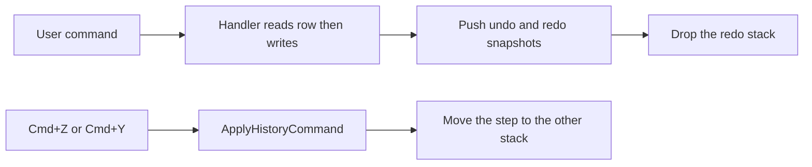

# PLAN: Session undo and redo

Add session-only Cmd+Z / Cmd+Y undo and redo for every library command except opening a file and panel settings. Leave the Prisma schema unchanged. There is no separate audit schema. Audit events do not hold a before-image, so a separate in-memory history stack records one.

## 0. Schema

Leave [`backend/prisma/schema.prisma`](../backend/prisma/schema.prisma) alone. That is the only schema this app uses. [`backend/src/main.ts`](../backend/src/main.ts) passes that Prisma client to `PrismaAuditEventRepository`, so `event_audit` rows land in the same database. This feature does not add a second schema or a second database.

`event_audit` is a log of what was asked, not a before-image. A rename event stores the new name. A strip update event stores ids and the new page, not the old geometry or remark. A delete event stores a count, not the row, and the library file is unlinked after commit. Replaying that log backward cannot restore the library. Undo commands will still be audited like any other command, so the event log shows them; it is not the stack you walk.

The stack lives in the backend process. It dies when that process quits, and it survives a webview reload. Both windows share one stack, which matches one library.

## 1. What is one step

One successful top-level command is one step. Remark saves and band resizes already commit once per gesture, so there is nothing to coalesce.

Record these commands:

- import, rename, delete, and reorder of documents
- create, rename, delete, and reorder of folders
- create, update, delete, and reorder of strips

Skip these, including when a policy sends them as a nested command:

- `UpdateAppStateCommand` (panel widths)
- `ResolvePdfDocumentCommand` (open a file, last-opened document)

Skip an import that only finds an existing document. A legacy import that rewrites `file_path` / `content_hash` is a real step.

Creating the first strip can also create the default folder, and importing a document shifts every other document down via `placeNewDocumentFirst`. Those side effects belong to the same step. Snapshot the extra folder, or the previous `{ id, ordering }[]`, inside that step so undo is one transaction.

## 2. Stack

Add an in-memory `SessionHistory` (it began in the notes context and now sits in
`backend/src/bounded-contexts/history-management/`, the context that owns the stack).
Each step stores a label plus two snapshots: `undo` and `redo`. Apply them through one new command, `ApplyHistoryCommand`, so the existing unit of work wraps the whole step in one transaction.

Rules:

- A new user command clears the redo stack.
- While a step is being applied, recording is suspended, so the inverse command does not push another step and a nested `UpdateAppState` does not either.
- Cap the undo stack (about 100). Dropping the oldest step makes that action permanent.
- Serialize pop-and-apply so the two windows cannot pop the same step.
- An empty stack answers a quiet 409. The shortcut does not toast that.

Snapshots keep the original ids. Redo of "create strip" inserts that same id again, so `[note:<id>]` references stay valid. SQLite will accept an explicit id as long as the row is gone.

Restore shapes:

- update / rename / reorder: the previous and next values, replayed with the existing commands' writes
- create strip: the new strip row, plus the folder row if this command created it
- delete strip: the full strip row
- delete folder: the folder row and every strip the cascade removed
- delete or undo-import of a document: the document, its folders, its strips, and the document order from before the insert

## 3. Library files

Undoing a document delete has to bring the PDF back. Today [`PdfPolicy`](../backend/src/bounded-contexts/pdf-note-management/policy/PdfPolicy.ts) unlinks the library copy on `PdfLibraryCopyReleasedEvent` after commit.

Change that unlink into a move to `library/.trash/`. Startup deletes the trash directory, because the in-memory stack is already gone. Discarding a step that still points at a trash file deletes that file. Undo moves it back to `file_path` and reinserts the rows; redo moves it to trash again.

## 4. Backend touch points

- New `SessionHistory` plus `ApplyHistoryCommand` and its handler, registered in [`backend/src/bounded-contexts/components.ts`](../backend/src/bounded-contexts/components.ts).
- Each undoable handler already loads the existing row before it writes. After a successful write, it records the step. [`UpdateFocusableStripCommandHandler`](../backend/src/bounded-contexts/pdf-note-management/commandhandler/UpdateFocusableStripCommandHandler.ts) records only the fields the patch changed. [`DeleteFocusableStripCommandHandler`](../backend/src/bounded-contexts/pdf-note-management/commandhandler/DeleteFocusableStripCommandHandler.ts) records the row it just read. Import and delete record the tree and the previous document order.
- `POST /history/undo` and `POST /history/redo` send `ApplyHistoryCommand`. They return `{ label, canUndo, canRedo }`.

## 5. Keyboard and menu

[`src/appMenu.ts`](../src/appMenu.ts) uses the predefined Undo and Redo items. Those drive the webview's text undo, not the library. Replace them with menu items whose actions call the history endpoints. Accelerators: Cmd/Ctrl+Z and Cmd/Ctrl+Y.

Add a matcher next to [`src/shortcuts.ts`](../src/shortcuts.ts):

- Cmd/Ctrl+Z without Shift undoes
- Cmd/Ctrl+Y, and Cmd/Ctrl+Shift+Z, redo
- If the event target is inside `input`, `textarea`, `select`, `[contenteditable]`, or `.monaco-editor`, do nothing. Monaco already maps Cmd+Y to its own redo, and text fields keep their own undo.

Listen in the capture phase from both [`src/App.tsx`](../src/App.tsx) and [`src/DetachedNotesApp.tsx`](../src/DetachedNotesApp.tsx). One in-flight lock so a menu accelerator and a keydown cannot apply the same step twice.

The history mutation invalidates the document, folder, and strip list tags so both windows refetch.

## 6. Tests

- Stack: push, undo, redo, a new command drops redo, suspend does not record, empty stack.
- Rename, then undo, restores the previous name and the same id.
- Delete a strip, then undo, inserts that same row.
- Import shifts ordering; undo deletes the new document and restores the old order.
- Delete a document moves the file to trash; undo puts the file and the row back.
- The shortcut matcher ignores chords that start in a field or in Monaco.

## 7. Work list

- Add in-memory `SessionHistory` and `ApplyHistoryCommand` (one transaction per step, suspend while applying, cap and redo-clear).
- Record before/after snapshots from each undoable handler. Skip app state, resolve, and no-op imports. Include auto-created folders and document-order shifts.
- Move released library PDFs to `library/.trash` instead of unlinking. Restore on undo. Sweep trash on startup and when a step is discarded.
- Add `POST /history/undo` and `POST /history/redo`, and invalidate document, folder, and strip caches from the client.
- Bind Cmd/Ctrl+Z and Cmd/Ctrl+Y (plus Cmd/Ctrl+Shift+Z) outside text fields and Monaco, and point the Edit menu at the same actions.
